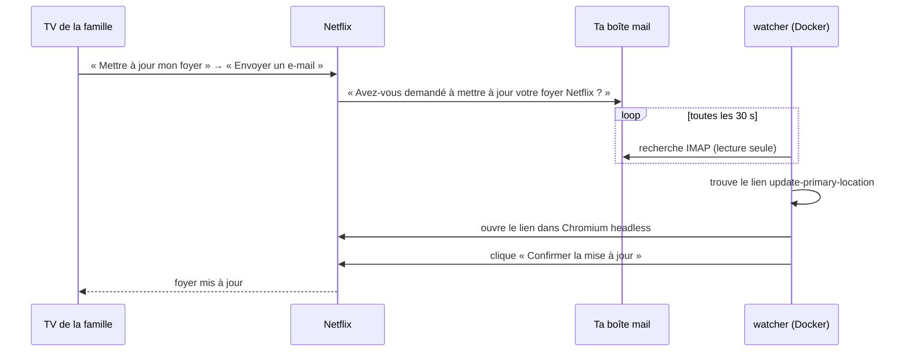

<div align="center">

# netflix-household-autoconfirm

**Confirme automatiquement les demandes de mise à jour du foyer Netflix, depuis ton propre serveur.**

[](https://github.com/Kylian14/netflix-household-autoconfirm/actions/workflows/test.yml)


[](LICENSE)

[English](README.md) · Français

</div>

---

Quand quelqu'un de ta famille ouvre Netflix sur une TV que Netflix ne considère pas comme faisant partie de ton foyer, il peut demander à **mettre à jour le foyer**. Netflix envoie alors un mail au titulaire du compte et attend : il faut cliquer **« Oui, c'était moi »** dans le mail, puis **« Confirmer la mise à jour »** sur la page Netflix, en 15 minutes environ. Si tu rates le mail, ta famille reste bloquée.

Cet outil surveille ta boîte mail et fait ces deux clics à ta place, en général moins d'une minute après l'arrivée du mail.

- **Toute boîte IMAP** : Gmail, Outlook, iCloud et les autres.
- **Lecture seule** : il ne marque, ne déplace et ne supprime jamais tes mails.
- **Toutes les langues** : le mail est repéré par son lien, pas par son sujet.
- **Pas de mot de passe Netflix** : le lien du mail contient son propre jeton à usage unique.
- **Aucun secret dans les logs** : jamais le lien, le jeton ni tes identifiants.
- **Un seul conteneur** : `docker compose up -d` sur un VPS, un Raspberry Pi ou un NAS.

## Fonctionnement



## Démarrage rapide

Il te faut Docker avec Docker Compose sur une machine toujours allumée, et un **mot de passe d'application** IMAP pour ta boîte mail (pas ton mot de passe habituel).

**1. Créer un mot de passe d'application**

| Fournisseur | Où |
|---|---|
| Gmail | [Mots de passe d'application Google](https://support.google.com/accounts/answer/185833) (validation en deux étapes requise) |
| Outlook / Hotmail | [Mots de passe d'application Microsoft](https://support.microsoft.com/fr-fr/account-billing/how-to-get-and-use-app-passwords-5896ed9b-4263-e681-128a-a6f2979a7944) |
| iCloud | [Mots de passe pour app Apple](https://support.apple.com/fr-fr/102654) |

**2. Installer et lancer**

```sh
git clone https://github.com/Kylian14/netflix-household-autoconfirm.git
cd netflix-household-autoconfirm
cp .env.example .env
```

Remplis `.env` :

```ini
IMAP_HOST=imap.gmail.com
IMAP_USER=toi@gmail.com
IMAP_PASSWORD=ton-mot-de-passe-d-application
```

```sh
docker compose up -d
```

**3. Vérifier que ça tourne**

```sh
docker compose logs -f
```

```text
INFO watching folder INBOX on imap.gmail.com every 30 s
INFO IMAP connected
```

Ensuite les logs restent silencieux jusqu'à l'arrivée d'un mail de foyer :

```text
INFO mail 1917a90d3790 confirmed
```

Le conteneur redémarre tout seul après un plantage ou un redémarrage de la machine.

## Configuration

Tous les réglages vont dans `.env`.

| Variable | Obligatoire | Défaut | Description |
|---|---|---|---|
| `IMAP_HOST` | oui | | Serveur IMAP, ex. `imap.gmail.com`, `outlook.office365.com`, `imap.mail.me.com` |
| `IMAP_USER` | oui | | Ton adresse mail |
| `IMAP_PASSWORD` | oui | | Mot de passe d'application |
| `IMAP_PORT` | non | `993` | Port IMAP SSL |
| `IMAP_FOLDER` | non | `INBOX` | Dossier surveillé. Les noms avec espaces fonctionnent tels quels. |

Sur Gmail, `INBOX` inclut déjà les onglets Promotions et Mises à jour. N'utilise `[Gmail]/Tous les messages` (`[Gmail]/All Mail` sur un compte en anglais) que si un filtre archive les mails Netflix.

## En détail

- Toutes les 30 secondes, l'outil cherche dans le dossier les mails de « netflix » reçus depuis la veille. La boîte est ouverte **en lecture seule** (`BODY.PEEK`, aucun flag modifié).
- Un mail est une demande de foyer s'il contient un lien `https://www.netflix.com` (ou `netflix.com`) vers `update-primary-location`. Les liens vers tout autre site ne sont jamais ouverts : un faux mail « Netflix » ne peut pas envoyer le navigateur ailleurs. Le lien « modifier votre mot de passe » du même mail est ignoré.
- Les mails de plus de **15 minutes** sont ignorés : le lien a expiré.
- Le lien est ouvert dans Chromium headless. L'outil clique le bouton « Confirmer la mise à jour », « Confirm update » ou son équivalent espagnol, allemand, italien ou portugais. En secours, il clique l'unique bouton d'envoi de la page, mais jamais sur une page de connexion.
- Un essai raté est retenté au cycle suivant, **3 fois au maximum** par mail, et une capture de la page est enregistrée dans `screenshots/`.
- Les mails traités sont mémorisés en mémoire uniquement. Après un redémarrage, un mail récent peut être retenté ; Netflix refuse un lien déjà utilisé et l'outil loggue un échec.

## Confidentialité et sécurité

- L'outil ne fait que lire. Il n'a besoin ni d'un accès en écriture à ta boîte, ni de tes identifiants Netflix.
- Le navigateur n'ouvre que des liens `https://` sur `netflix.com`, quoi que prétende le mail.
- Le mot de passe d'application donne un accès complet à cette boîte. Pour la configuration la plus sûre, transfère uniquement les mails Netflix vers une boîte dédiée et fais-la surveiller par l'outil. Tu peux révoquer le mot de passe d'application à tout moment.
- Le jeton de connexion du lien n'apparaît jamais dans les logs. Chaque mail y figure sous forme d'un hash de 12 caractères.
- Les erreurs sont loguées par type d'exception uniquement. Les erreurs IMAP affichent aussi la réponse du serveur (ex. `AUTHENTICATIONFAILED`), qui ne contient ni ton mot de passe ni le lien.
- Les captures d'écran peuvent montrer ta page de compte Netflix. Elles restent dans `screenshots/` sur ta machine, ignoré par git.
- `.env` est ignoré par git et exclu de l'image Docker.

## FAQ

**Comment la famille envoie-t-elle la demande ?**
Sur sa TV, quand Netflix affiche « Cette TV ne fait pas partie de votre foyer Netflix », elle choisit **Mettre à jour mon foyer**, puis **Envoyer un e-mail**.

**Est-ce qu'il accepte toutes les demandes ?**
Oui, quel que soit l'expéditeur. Si quelqu'un d'autre connaît ton mot de passe Netflix, change-le : c'est l'avertissement que Netflix met dans ce même mail.

**Peut-on tester sans TV ?**
Pas avec Netflix : seule une TV sur un autre réseau déclenche le mail. Les tests automatiques couvrent tout jusqu'au clic avec des pages locales.

**Ça marche sur un Raspberry Pi ?**
Oui. L'image Playwright est publiée pour amd64 et arm64.

## Dépannage

| Ligne de log | Quoi faire |
|---|---|
| `Missing required environment variable(s): ...` et le conteneur redémarre en boucle | Remplis `.env`, puis `docker compose up -d` |
| `tick failed: error: ... AUTHENTICATIONFAILED ...` toutes les 30 s | Vérifie le mot de passe d'application, que l'IMAP est activé, l'hôte et le port |
| Rien du tout après une demande | Vérifie que le mail est arrivé dans le dossier surveillé et date de moins de 15 minutes. Sur Gmail, voir `IMAP_FOLDER` plus haut |
| `mail ... confirm failed (attempt n/3)` | Ouvre la dernière image de `screenshots/`. Si Netflix affiche un bouton inconnu de l'outil, [ouvre une issue](https://github.com/Kylian14/netflix-household-autoconfirm/issues) avec son libellé exact |

## Sans Docker

Python 3.12 est requis.

```sh
python -m venv .venv
.venv/bin/pip install -r requirements.txt
.venv/bin/playwright install chromium
export IMAP_HOST=imap.example.com IMAP_USER=toi@example.com IMAP_PASSWORD=...
.venv/bin/python watcher.py
```

## Développement

```sh
.venv/bin/pip install -r requirements-dev.txt
.venv/bin/playwright install chromium
.venv/bin/pytest
```

Tout l'outil tient dans un seul fichier, `watcher.py`. Les tests utilisent de faux serveurs IMAP et des pages HTML locales dans `tests_fixtures/`, jamais Netflix. Les pull requests qui ajoutent des libellés de bouton pour d'autres langues sont les bienvenues.

## Avertissement

Outil non officiel, sans lien avec Netflix ni approuvé par Netflix. À utiliser uniquement sur ton propre compte. Tu es responsable du respect des conditions d'utilisation de Netflix.

## Licence

[MIT](LICENSE)
