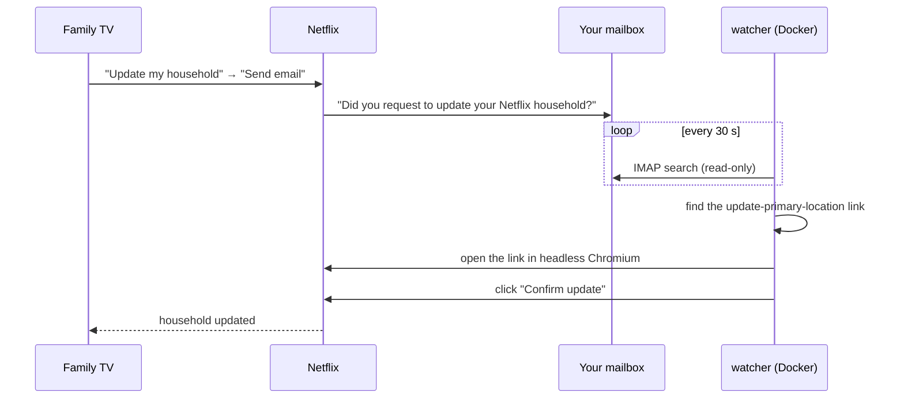

<div align="center">

# netflix-household-autoconfirm

**Confirm Netflix "update household" requests automatically, from your own server.**

[](https://github.com/Kylian14/netflix-household-autoconfirm/actions/workflows/test.yml)


[](LICENSE)

English · [Français](README.fr.md)

</div>

---

When someone in your family opens Netflix on a TV that Netflix does not consider part of your household, they can ask to **update the household**. Netflix then emails the account owner and waits: the owner has to click **"Yes, it was me"** in the email, then **"Confirm update"** on the Netflix page, within about 15 minutes. If you miss the email, they are stuck.

This tool watches your mailbox and does those two clicks for you, usually within a minute of the email arriving.

- **Any IMAP mailbox**: Gmail, Outlook, iCloud and others.
- **Read-only**: it never marks, moves or deletes your mail.
- **Any language**: the email is detected by its link, not its subject.
- **No Netflix password**: the link in the email carries its own one-time token.
- **No secrets in logs**: never the link, the token or your credentials.
- **One container**: `docker compose up -d` on a VPS, Raspberry Pi or NAS.

## How it works



## Quick start

You need Docker with Docker Compose on a machine that stays on, and an IMAP **app password** for your mailbox (not your normal password).

**1. Create an app password**

| Provider | Where |
|---|---|
| Gmail | [Google app passwords](https://support.google.com/accounts/answer/185833) (requires 2-Step Verification) |
| Outlook / Hotmail | [Microsoft app passwords](https://support.microsoft.com/en-us/account-billing/how-to-get-and-use-app-passwords-5896ed9b-4263-e681-128a-a6f2979a7944) |
| iCloud | [Apple app-specific passwords](https://support.apple.com/en-us/102654) |

**2. Install and start**

```sh
git clone https://github.com/Kylian14/netflix-household-autoconfirm.git
cd netflix-household-autoconfirm
cp .env.example .env
```

Edit `.env`:

```ini
IMAP_HOST=imap.gmail.com
IMAP_USER=you@gmail.com
IMAP_PASSWORD=your-app-password
```

```sh
docker compose up -d
```

**3. Check it is running**

```sh
docker compose logs -f
```

```text
INFO watching folder INBOX on imap.gmail.com every 30 s
INFO IMAP connected
```

From then on the log stays quiet until a household email arrives:

```text
INFO mail 1917a90d3790 confirmed
```

The container restarts on its own after a crash or a reboot.

## Configuration

All settings go in `.env`.

| Variable | Required | Default | Description |
|---|---|---|---|
| `IMAP_HOST` | yes | | IMAP server, e.g. `imap.gmail.com`, `outlook.office365.com`, `imap.mail.me.com` |
| `IMAP_USER` | yes | | Your email address |
| `IMAP_PASSWORD` | yes | | App password |
| `IMAP_PORT` | no | `993` | IMAP over SSL port |
| `IMAP_FOLDER` | no | `INBOX` | Folder to watch. Names with spaces work as-is. |

On Gmail, `INBOX` already includes the Promotions and Updates tabs. Use `[Gmail]/All Mail` only if a filter archives Netflix mail; this name is localized (`[Gmail]/Tous les messages` on a French account).

## Details

- Every 30 seconds the tool searches the folder for emails from "netflix" received since yesterday, with the mailbox opened **read-only** (`BODY.PEEK`, no flags changed).
- An email is a household request if it contains an `https://www.netflix.com` (or `netflix.com`) link to `update-primary-location`. Links to any other host are never opened, so a fake "Netflix" email cannot send the browser elsewhere. The "change your password" link in the same email is ignored.
- Emails older than **15 minutes** are skipped: the link has expired.
- The link is opened in headless Chromium. The tool clicks the button labelled "Confirmer la mise à jour", "Confirm update", or the Spanish, German, Italian or Portuguese equivalent. As a fallback it clicks the page's only submit button, but never on a login page.
- A failed attempt is retried on the next poll, **up to 3 times** per email, and a screenshot of the page is saved to `screenshots/`.
- Handled emails are remembered in memory only. After a restart, a recent email may be tried again; Netflix refuses a used link and the tool logs a failure.

## Privacy and security

- The tool only reads. It needs no write access to your mailbox and no Netflix credentials.
- The browser only ever opens `https://` links on `netflix.com`, whatever the email claims to be.
- The app password grants full access to that mailbox. For the tightest setup, forward only Netflix emails to a dedicated mailbox and point the tool at it. You can revoke the app password at any time.
- The login token in the email link never reaches the logs. Each email appears as a 12-character hash.
- Errors are logged by exception type only. IMAP errors also show the server's reply (e.g. `AUTHENTICATIONFAILED`), which contains neither your password nor the link.
- Screenshots may show your Netflix account page. They stay in `screenshots/` on your machine, which git ignores.
- `.env` is ignored by git and excluded from the Docker image.

## FAQ

**How do family members send the request?**
On their TV, when Netflix shows "This TV isn't part of your Netflix household", they choose **Update my household**, then **Send email**.

**Does it accept every request?**
Yes, whoever sends it. If someone else knows your Netflix password, change it: that is the warning Netflix puts in the same email.

**Can I test it without a TV?**
Not with Netflix itself: only a TV on another network triggers the email. The test suite covers everything up to the click with local pages.

**Does it work on a Raspberry Pi?**
Yes. The Playwright image is published for amd64 and arm64.

## Troubleshooting

| Log line | What to do |
|---|---|
| `Missing required environment variable(s): ...` and the container restarts | Fill in `.env`, then `docker compose up -d` |
| `tick failed: error: ... AUTHENTICATIONFAILED ...` every 30 s | Check the app password, that IMAP is enabled, the host and the port |
| Nothing at all after a request | Check the email reached the watched folder and is less than 15 minutes old. On Gmail, see `IMAP_FOLDER` above |
| `mail ... confirm failed (attempt n/3)` | Open the latest image in `screenshots/`. If Netflix shows a button the tool does not know, [open an issue](https://github.com/Kylian14/netflix-household-autoconfirm/issues) with its exact label |

## Running without Docker

Python 3.12 is required.

```sh
python -m venv .venv
.venv/bin/pip install -r requirements.txt
.venv/bin/playwright install chromium
export IMAP_HOST=imap.example.com IMAP_USER=you@example.com IMAP_PASSWORD=...
.venv/bin/python watcher.py
```

## Development

```sh
.venv/bin/pip install -r requirements-dev.txt
.venv/bin/playwright install chromium
.venv/bin/pytest
```

The whole tool is one file, `watcher.py`. Tests run against fake IMAP servers and local HTML pages in `tests_fixtures/`, never against Netflix. Pull requests that add button labels for other languages are welcome.

## Disclaimer

This is an unofficial tool, not affiliated with or endorsed by Netflix. Use it only on your own account. You are responsible for complying with Netflix's terms of use.

## License

[MIT](LICENSE)
